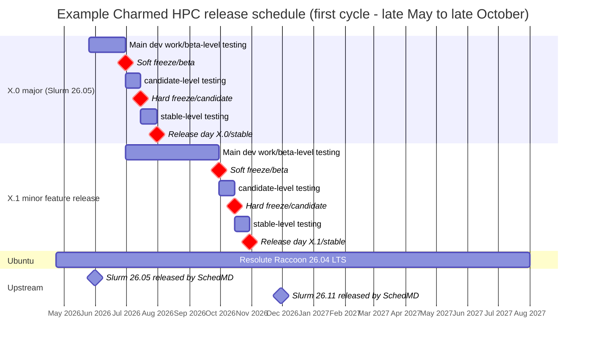

# Release policy for Charmed HPC

## Abstract

This specification defines the release policy for Charmed HPC, a single product underpinned by a portfolio of charms and supporting artifacts.

Releases are numbered `<major>.<minor>`. A major release may introduce breaking changes and new major upstream versions; a minor release may not. Within a major release, components are forward compatible, so a component from an older minor release continues to interoperate with newer ones, although it cannot use features introduced after it.

There are two scheduled release slots per six-month cycle: one major release, which batches breaking changes and new major upstream versions such as Slurm, and one minor feature release. Any release may carry bug and security fixes, but a minor patch release carries nothing else; these fall outside the schedule entirely and are cut as needed, with their timing gated on the criticality of the issue being fixed rather than on the cycle calendar. Each release is built against a single Ubuntu base, which can only change in a major release.

Within a scheduled cycle, three freeze points - soft freeze, hard freeze, and release day - gate the promotion of each charm between risk statuses. This specification defines those freeze points and what must be complete by each. The risk statuses themselves (`edge`, `beta`, `candidate`, `stable`) and the testing required to reach each are defined in the companion [UHPC 017](../UHPC%20017%20-%20Charm%20and%20solution%20promotion%20criteria%20for%20Charmed%20HPC/uhpc017.md).

Finally, this specification sets out what every release must publish about itself: the artifact and third-party charm versions tested together, the supported Ubuntu base and Juju range, and the breaking changes, deprecations, and known issues users need to act on. The accompanying [Release Notes Template](release-notes-template.md) provides the concrete format.

## Rationale

A consistent release policy is necessary to keep our stakeholders aware of upcoming major changes, bug fixes, and security updates, while ensuring that there is some expected degree of stability.

Charmed HPC is a composition of multiple charms and supporting artifacts, some of which (for example, the Slurm charms) operate upstream projects that follow their own release cadences. There must be a well-defined, product-wide release policy that developers and users can reference to know:

* When new features can be expected (the one scheduled major release and minor feature release per cycle) as distinct from when bug fixes and security updates can be expected (any release may carry them, and unscheduled minor patch releases are cut as needed for those that cannot wait).
* Which charm versions have been verified to work together as a single Charmed HPC release.
* What compatibility guarantees apply to a `stable` channel (no breaking changes to integrations, configuration options, or actions).
* How components from different minor releases of the same major release behave when deployed together, and what is tested.
* What information is published in release notes, and in what format.
<!--* **[DECISION NEEDED]** How long a given Charmed HPC release is supported, and what "end of support" means.-->

Without such a policy, users cannot reliably schedule upgrades, security patching, or feature adoption across a Charmed HPC deployment, and the maintainers lack a shared reference for release planning, freeze dates, and channel promotion criteria.

## Specification

### Artifacts

Charmed HPC artifacts:

<!-- Update this list as the Charmed HPC portfolio evolves -->

- slurm-charms:
  - sackd
  - slurmctld
  - slurmd
  - slurmdbd
  - slurmrestd
- lustre-server
- filesystem-charms:
  - cephfs-server-proxy
  - filesystem-client
  - lustre-server-proxy
  - nfs-server-proxy
- apptainer-operator
- openssh-operator
- sssd-operator

An artifact is listed above if it is maintained by the Charmed HPC team and is deployed by the user as part of a Charmed HPC deployment. On this basis, dependencies that are not user-facing are **not** listed as release artifacts and are not versioned in the release notes. For example, `charmed-hpc-libs` (see [UHPC 008](../UHPC%20008%20-%20%60charmed-hpc-libs%60%20for%20HPC%20charm%20development/uhpc008.md)) and the Slurm interface packages (see [UHPC 009](../UHPC%20009%20-%20Distributing%20Slurm%20interfaces%20as%20Python%20packages/uhpc009.md)) are internal development dependencies that a user does not interact with directly; versions are pinned within charm releases to account for updates in these dependencies.

#### Compatible third-party charms

Each Charmed HPC release records the third-party charm versions it has been tested against. These charms (for example, `mysql`, `smtp-integrator`) are not Charmed HPC artifacts and are not released by the Charmed HPC team but are used as part of Charmed HPC deployments. A release is only supported in combination with the third-party charm versions listed; the channel and revision of each are recorded in the release notes (see the [Release Notes Template](release-notes-template.md)).

<!-- Update these lists as Charmed HPC dependencies evolve -->
Third-party machine charms:
- cephfs - for filesystems
- ldap-integrator - for identity; to integrate with an existing LDAP deployment
- microceph - for filesystems
- mysql - backing database for Slurm
- opentelemetry-collector - for observability; metric collection
- smtp-integrator - for email notifications

Third-party Kubernetes charms:
- authentik-server - for identity
- authentik-worker - for identity
- authentik-ldap-outpost - for identity
- postgresql-k8s - for identity; backing database for Authentik
- traefik-k8s - enables ingress for COS and Authentik deployments

Charmed HPC also integrates with the Canonical Observability Stack (COS); however, COS is a large group of charms rather than a single charm or a small set. Enumerating each COS charm alongside the third-party charms above would duplicate information that the Observability team already maintains, so the release notes instead record the supported COS **track** as part of the third-party charm versions and link to the component versions published for that track (for example, the [COS 3.0 release notes](https://documentation.ubuntu.com/observability/track-3.0/release-notes/) and the [COS 3.0 components reference](https://documentation.ubuntu.com/observability/track-3.0/reference/cos-components/)).

### Versioning scheme

Version format: `<major>.<minor>`.

Charmed HPC has three kinds of release. One is a major release; the other two are minor releases, distinguished as a minor feature release and a minor patch release:

| Kind | Version change | Timing | Contains |
|------|----------------|--------|----------|
| **Major release** | `X.Y` → `X+1.0` | Scheduled, once per six-month cycle | Breaking changes (integrations, configuration options, actions, Ubuntu base) and/or new major upstream releases (for example, Slurm 27.05); may also contain new features, bug fixes, and/or security fixes |
| **Minor feature release** | `X.Y` → `X.Y+1` | Scheduled, once per six-month cycle; subject to the freeze points in [Release cycle and feature freezes](#release-cycle-and-feature-freezes) | New features, and any bug fixes and/or security fixes ready at the time it is cut; no breaking changes, no new major upstream releases (may contain minor upstream patches) |
| **Minor patch release** | `X.Y` → `X.Y+1` | Unscheduled, as needed; timing gated on criticality | Bug fixes and/or security fixes only; no new features, no breaking changes, no new major upstream releases (may contain minor upstream patches)|

A minor feature release may also include whatever bug and security fixes are ready when it is cut, while a minor patch release is restricted to fixes alone. A major release may likewise include fixes alongside its breaking changes and upstream updates.

Both minor releases increment the same minor component, so the version number alone does not distinguish a minor feature release from a minor patch release. The release notes state which kind a release is (see [Release notes sections](#release-notes-sections)).

Example sequence of Charmed HPC release numbers:

- `1.0` - major release (initial)
- `1.1` - minor patch release (security fix, issued three weeks later)
- `1.2` - minor feature release (the cycle's scheduled feature slot)
- `1.3` - minor patch release (bug fix)
- `2.0` - major release (next six-monthly slot; new upstream releases and/or breaking changes)
- `2.1` - minor feature release (next cycle's scheduled feature slot)

#### Supported versions

The release notes for each Charmed HPC release list the supported Ubuntu base, the supported Juju version range, the upstream versions the release is built and tested against, and the versions of each Charmed HPC artifact and third-party charm included in or tested with the release. Only the listed versions are tested together as a release.

#### Upstream versions

Each release records the **exact** upstream version it is built and tested against for each of the following projects:

<!-- Update this list as the Charmed HPC portfolio evolves -->

| Upstream project | Provided by |
|------------------|-------------|
| Slurm | slurm-charms (`slurmctld`, `slurmd`, `slurmdbd`, `sackd`, `slurmrestd`) |
| Lustre | `lustre-server`, `lustre-server-proxy` |
| OpenSSH | `openssh-operator` |
| SSSD | `sssd-operator` |
| Apptainer | `apptainer-operator` |

The upstream **major** version is held stable for the lifetime of a Charmed HPC major release, so moving to a new upstream major version requires a new Charmed HPC major release. The exact version recorded in the release notes may still change across minor releases of the same major release, because a minor patch release may pick up an upstream patch (see [Versioning scheme](#versioning-scheme)).

#### Supported Juju versions

Each release records a supported Juju version range in its release notes. The supported Juju **minor** version range may change between minor releases of the same Charmed HPC major release, provided the change introduces no breaking changes. Requiring a new Juju **major** version is a breaking change, so it only occurs in a new Charmed HPC major release.

#### Compatibility between minor releases

Charmed HPC components from different minor releases of the same major release are designed to be **forward compatible**: a component from an older minor release can interact with, and accept data and components from, a newer minor release of the same major release, although features introduced in the newer minor release will not be available to it. To use a new feature, all components that participate in it must be refreshed to the minor release that introduced it, or later.

Forward compatibility within a major release is achieved by holding the following stable for the lifetime of that major release:

* **Component interfaces** - the integrations exchanged between Charmed HPC charms. Interfaces may gain optional additions, but existing fields and semantics do not change.
* **Ubuntu base** - see [Ubuntu base support](#ubuntu-base-support).
* **Upstream major versions** - the major upstream versions the release is built and tested against, as recorded per release (see [Upstream versions](#upstream-versions)). For example, all Charmed HPC `1.X` releases are built and tested against Slurm 25.11.
* **Juju major version** - see [Supported Juju versions](#supported-juju-versions).

Changes to any of the above are breaking changes and are therefore only made in a new major release. There is no compatibility promise between components from **different major releases** (for example, mixing `1.X` and `2.X` components); such combinations are not supported.

#### Deprecation within a major release

A new feature may deprecate an existing feature within the same major release. When this happens:

* The deprecation is announced in the release notes of the release that introduces the replacement, together with the recommended alternative.
* The deprecated feature continues to be supported for an announced period of time or number of releases, which is stated at the point of deprecation.
* Removal of the deprecated feature is a breaking change and therefore only occurs in a new major release, at or after the end of the announced support period.
* A deprecation warning message will be emitted or logged each time the deprecated feature is used. A replacement feature will be mentioned in the message when appropriate.

#### Mixed-version deployments

The number of possible combinations of Charmed HPC component versions makes exhaustive cross-component version testing impractical, so **mismatched component versions are not officially tested**. Testing is performed against the set of versions listed in a single release's release notes.

Mismatched versions within the same major release are intended to work by virtue of the forward compatibility design described above, but are not guaranteed. Issues encountered with newer and/or unvalidated component versions are accepted on GitHub and community contributions are welcome to address compatibility bugs; the common resolution for reported issues involving older and/or unvalidated component versions will be to update to a supported component version set.

#### Ubuntu base support

Each Charmed HPC major release is built against the latest Ubuntu LTS release at the time it is cut, and all minor releases within that major release use the same base. A given Charmed HPC release supports a single Ubuntu base; running a release on any other base, including an older LTS, is not supported. The supported base is listed in the release notes for each release.

Moving to a new Ubuntu base is a breaking change, so a new base is only introduced in a new major release.

### Release cadence

Charmed HPC has two scheduled release slots per six-month cycle (four per year): one major release and one minor feature release, alternating approximately every three months. Cycles are late May to late October and early November to early May.

* **Major releases** (`X+1.0`) occupy one scheduled slot per cycle. A major release batches together breaking changes and/or new upstream releases of the underlying software (such as Slurm and Lustre); for example, a major release cut in October 2027 would include Slurm 27.05. Breaking changes and new upstream releases are held back from minor releases until the next major release. If there are no breaking changes or new upstream releases to batch, that slot is a minor feature release instead.
* **Minor feature releases** (`X.Y+1`) occupy the other scheduled slot per cycle, intended to be between major releases. Each contains new features that introduce no breaking changes, together with any bug and security fixes ready at the time it is cut.

Minor patch releases are **not** part of this schedule and do not consume a slot.

#### Minor patch releases

Minor patch releases (bug and security fixes) are **unscheduled**. They are cut as needed, outside the two scheduled slots, and their timing is gated on the criticality of the issue being fixed rather than on the cycle calendar. A cycle may contain any number of minor patch releases, including none - a fix that is not urgent enough to warrant its own release may instead ship in the next scheduled release.

#### Release channels and branches

Since Charmed HPC is a set of charms rather than a single charm, release channels apply to each constituent charm individually. The channel and branch model - tracks, the `edge`/`beta`/`candidate`/`stable` risk ladder, and the track-to-branch mapping - is defined in [UHPC 017](../UHPC%20017%20-%20Charm%20and%20solution%20promotion%20criteria%20for%20Charmed%20HPC/uhpc017.md).

* No breaking changes will be made to integrations, configuration options, or actions within a stable channel of a charm.

#### Release cycle and feature freezes

Two distinct concepts drive the release cycle: the **risk status** a charm can be published at, and the **freeze points** in time that gate promotion between them. The risk statuses (`edge`, `beta`, `candidate`, `stable`) and the testing required to reach each are defined in [UHPC 017](../UHPC%20017%20-%20Charm%20and%20solution%20promotion%20criteria%20for%20Charmed%20HPC/uhpc017.md).

Freeze points apply **only to the two scheduled release slots**: major releases and minor feature releases. Minor patch releases are not subject to freeze points; their timing is set by criticality, as described in [Minor patch releases](#minor-patch-releases).

##### Freeze points

Freeze points are the dates by which the **final** round of testing for a risk status must be complete. Testing is not confined to these dates: charms are tested against the rest of the Charmed HPC set throughout the cycle, and a charm may complete beta- or candidate-level testing well before the corresponding freeze. The freeze is the point at which the last such round must have finished for a charm to be approved for the corresponding release.

* **Soft freeze** — the date by which final beta-level testing must be complete. New feature work targeting this release stops, and each charm that has passed testing is promoted from edge to beta. Development of features targeting the *next* release continues.
* **Hard freeze** — the date by which final candidate-level testing must be complete. Each charm that has passed testing is promoted from beta to candidate.
* **Release day** — the date by which final stable-level testing must be complete. All charms that have passed testing are promoted from candidate to stable.

Given the variety of charms, the candidate or stable **revision** of a given charm may be the same as the one in the prior release: a charm with no changes in a release is not rebuilt, and the revision already published is carried forward.

Freeze dates are set by the Charmed HPC team during cycle planning. Because scheduled releases are three months apart, development overlaps: work targeting the next release may immediately begin at the previous release's soft freeze.

<!--**[DECISION NEEDED]** Define what happens when a charm does not complete the required testing by a freeze point. Is the release delayed until the charm passes, is the charm published at a lower risk status, or is the charm held back at its previous revision while the rest of the release proceeds?-->

The example schedule below places each soft freeze one month before its release day, with the hard freeze midway between; these intervals are illustrative rather than policy.

<!--
Example continuation into the second cycle (early November to early May):

section X+1.0 major (Slurm 26.11)
    Main dev work/beta-level testing                        :f7, 2026-09-30, 2026-12-31
    Soft freeze/beta                                        :crit, milestone, v5, 2026-12-31, 0d
    candidate-level testing                                 :f8, 2026-12-31, 2027-01-15
    Hard freeze/candidate                                   :crit, milestone, v6, 2027-01-15, 0d
    stable-level testing                                    :f9, 2027-01-15, 2027-01-29
    Release day X+1.0/stable                                :crit, milestone, r3, 2027-01-29, 0d
section X+1.1 minor feature release
    Main dev work/beta-level testing                        :f10, 2026-12-31, 2027-03-31
    Soft freeze/beta                                        :crit, milestone, v7, 2027-03-31, 0d
    candidate-level testing                                 :f11, 2027-03-31, 2027-04-15
    Hard freeze/candidate                                   :crit, milestone, v8, 2027-04-15, 0d
    stable-level testing                                    :f12, 2027-04-15, 2027-04-30
    Release day X+1.1/stable                                :crit, milestone, r4, 2027-04-30, 0d
-->

<!---
**[TODO: Fill this section in following 27.04 cycle decisions/updates]**
### Support life-cycle

Bug and security fix support for each Charmed HPC release is tied to the **Ubuntu LTS** release it is built against, and is provided under the terms of **Ubuntu Pro** support.

> **[DECISION NEEDED]** With a major release every six months, tying support to the Ubuntu LTS would leave several major releases in support at once. How many major releases are supported concurrently, and does each remain supported for the full lifetime of its Ubuntu LTS?

> **[DECISION NEEDED]** Confirm that Charmed HPC is in scope for Ubuntu Pro, and at which tier, and link to the authoritative statement of those terms. The support commitment published in the release notes should cite it directly.

> **[DECISION NEEDED]** SchedMD supports each Slurm release for 18 months. Tying Charmed HPC support to the Ubuntu LTS cycle is a significantly longer commitment, so a Charmed HPC release would remain in support after upstream support for the Slurm version it contains has ended. This specification needs to state how bug and security fixes are provided for the Slurm charms within a supported Charmed HPC release once upstream support has ended.
-->

### Documentation and Release Notes

Warnings and limitations that will be included in the published documentation alongside the release notes:

* Charmed HPC components from different minor releases of the same major release are designed to be forward compatible: older components can interact with newer ones, but features introduced in a newer minor release are not available to components from an older minor release.
* Only the set of versions listed in a single release's release notes is tested together.
  * Issues encountered with newer and/or unvalidated component versions should be opened on GitHub; they are accepted, and community contributions to address compatibility bugs are welcome. For issues involving older and/or unvalidated component versions, the common resolution will be to update to a supported component version set.
* There is no compatibility promise between components from different major releases; such combinations are not supported.
* Deprecated features remain supported for the period of time or number of releases announced at the point of deprecation, and are only removed in a new major release.

#### Publishing and versioning release notes

Release notes pages are created per major release. Each major release has one release notes page, and the notes for every subsequent minor release within that major release - both minor feature releases and minor patch releases - are appended to the top of that same page. A reader on the page for a given major release therefore sees its full release history in one place, in reverse-chronological order with the most recent release first, rather than having to visit a separate page per minor release.

Each major release also has a dedicated branch in the documentation repository, with a corresponding version option in the published documentation's version selector. That branch is updated as each minor release in the series is cut. Readers select the major release they are running from the version selector and see documentation and release notes that correspond to the latest minor release for that major release (or the major release itself if no minor releases have been cut).

#### Release Notes Template

See the [Release Notes Template](release-notes-template.md) for the template used when drafting a new release's notes. The template is used in full for a major release, where it forms the initial content of that release's page, and piecemeal for a minor release, where the applicable sections are appended to the top of the existing page. The template is expected to be refined as releases are completed and the process settles.

#### Release notes sections

General release notes sections for Charmed HPC:

* Release summary, stating the release type: major release, minor feature release (scheduled), or minor patch release (unscheduled)
* Artifacts and versions included in the release
* What's new (features and improvements) - omitted for minor patch releases, which add no features
* Bug fixes and security fixes
* Requirements and compatibility (upstream versions, Ubuntu base, Juju version range, compatible third-party charm versions)
* Breaking changes
* Deprecated features
* Known issues

<!--* Upgrade notes (including `juju refresh` instructions)-->
<!--* Support lifecycle-->
* Acknowledgements

<!--
**[TODO: Fill in this section once 27.04 Upgrade Story epic is complete]**
#### Upgrades

Only upgrades between **minor versions** within the same major release are supported. There is no in-place upgrade path between major releases.

> **[DECISION NEEDED]** Define the migration or replacement path between major releases, given that in-place major upgrades are not supported. Is the expectation that users deploy a new cluster alongside the existing one and migrate, and what guidance and tooling is provided?

> **[DECISION NEEDED]** Are minor upgrades required to be sequential (for example, `.1` to `.2` to `.3`), or may versions be skipped? Review proposed supporting only sequential upgrades initially.

Refreshing all charms in a deployment to the same Charmed HPC release is recommended, since only that combination is tested. Refreshing a subset of charms to a newer minor release within the same major release is expected to work by virtue of forward compatibility, but is not officially tested, and features introduced in the newer minor release are unavailable until all participating charms are refreshed.

> **[DECISION NEEDED]** A refresh necessarily passes through a state where some charms are at the new release and others are not. Is this transient state supported during an upgrade, and if so, what refresh ordering is required?

> **[DECISION NEEDED]** Are downgrades supported, and if so between which versions?

> **[DECISION NEEDED]** How are database upgrades handled during a refresh, for example the `slurmdbd` schema and its MySQL backend? Define the required ordering of charm refreshes and any backup steps a user must take beforehand.
-->

## References
* [Canonical product release cycles](https://ubuntu.com/about/release-cycle#ubuntu)
